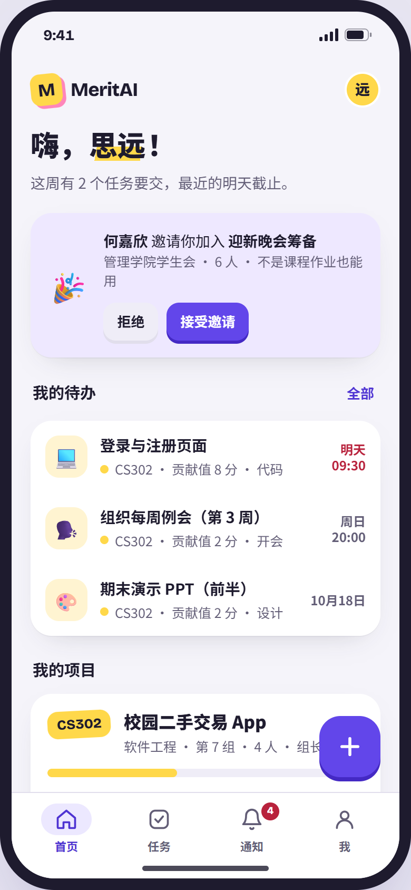
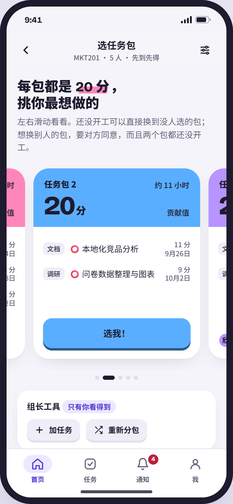
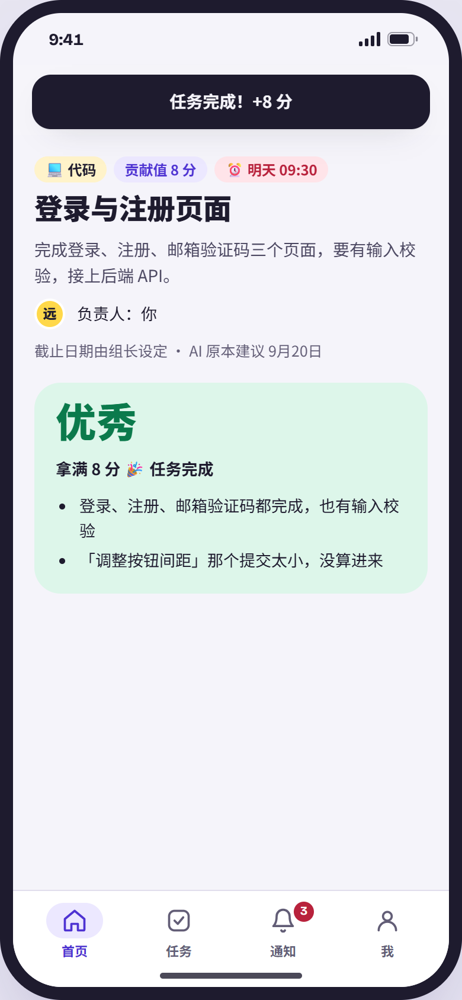
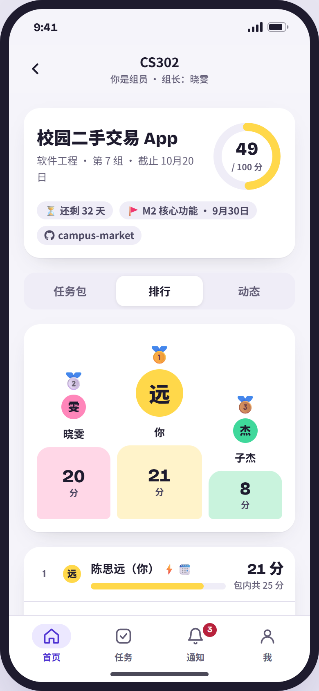
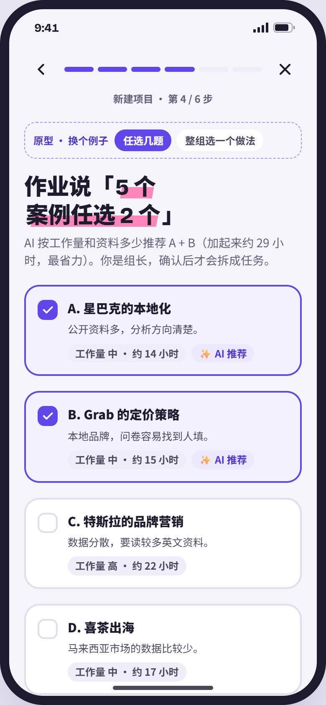
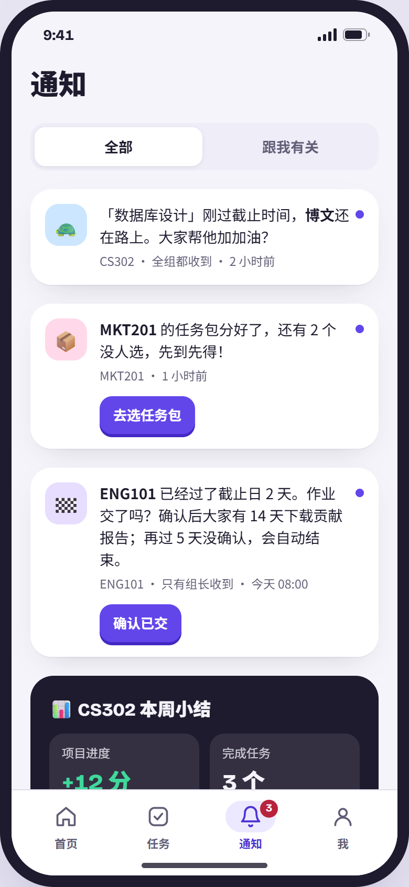
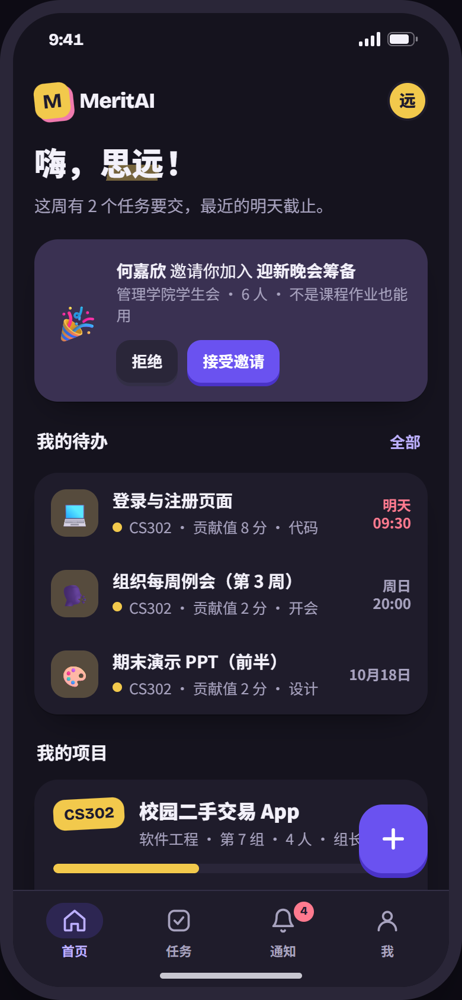

# MeritAI 🖍️

**Fair, transparent group projects.** AI breaks the assignment into tasks and splits them into equal packages, one per member, and evidence decides who did what.

  
  
  
  

> **Status:** in development, not released yet. Creating projects, picking packages, handing in evidence and grading already work on Android; reminders, AI review, sign-in and launch are in progress.

---

### What it is
Group projects usually go wrong in three ways: arguments over who does what, free-riders, and no clear record of who contributed. MeritAI handles all three:

- **AI task split, equal packages**: upload the brief (or just describe the project) and AI breaks it into tasks with contribution points, then splits them into one equal package per member. Members pick first come, first served.
- **Evidence decides**: submit commits, files or a Google Doc; when AI approves the evidence, the task completes automatically.
- **Everyone can see everything**: tasks, points and AI review results are visible to the whole team, with a leaderboard and badges.
- **Team Contribution Report**: a PDF at the end of the project showing who did what.

Built for student teams, and just as usable for clubs, competition teams and small companies. Coding and non-coding work (reports, slides, design, research) are both supported.

## How it works
1. **The team lead creates a project**: set the team size and deadline, then upload the brief, describe it in a few sentences, or add tasks by hand.
2. **AI splits the work**: the project is worth 100 contribution points, and each task gets a share. AI suggests a due date for every task, which the lead can change.
   - When the brief says "pick any 2 of these 5" or "choose one method" (e.g. Waterfall / Agile / RAD), AI recommends an option based on workload, and the lead confirms it before tasks are created.
3. **Pick a package**: tasks are split into equal packages, one per member.
   - Before you start, you can switch to any package nobody has picked.
   - Swapping with someone needs their consent, and neither package can have started.
   - The lead can re-split packages; only tasks nobody has started are moved.
4. **Submit evidence**:
   - **Code**: your commits are matched to the task automatically. When you're done, tap "I'm done" and AI grades all of them together.
   - **Files**: upload Word, PDF, slides or images, or pick a Google Doc from Google Drive.
   - **Meetings and coordination**: no file needed; mark the task done yourself.
5. **AI review**: results come in four grades (see Scoring below). The lead can override the AI, and the whole team sees the override.
6. **Reminders** follow due dates only, and each reminder is sent once:
   - 24 hours before a task is due, to the task owner.
   - When a task goes overdue, a light-hearted notice to the whole team.
   - A weekly summary every Sunday at 8 pm.
7. **Wrap-up**: after the deadline the lead confirms submission (the project ends automatically after 7 days). Everyone then has 14 days to download the Team Contribution Report, after which the project is deleted. Badges stay on your profile.

## Scoring
Your contribution = points of the tasks you completed × AI grade. Code, writing and meetings count the same way, and there is no participation baseline.

| AI grade | Points |
|---|---|
| Excellent | Full |
| Pass | Full |
| Half | Half |
| Fail | 0; resubmit, or the lead overrides |

## Platforms
- **Android**: native app; download the APK from GitHub Releases.
- **iPhone**: web app (PWA); open it in Safari and choose "Add to Home Screen".
- **Desktop**: web.
- Chinese and English interface, with light and dark mode.
- Sign in with GitHub or Google. If a project is connected to a GitHub repository, members connect GitHub so their commits can be matched.
- AI uses the key the team lead adds in project settings: Gemini (free tier available), Claude or OpenAI. Without a key, a rule-based parser splits tasks more roughly, and files can't be reviewed.

## Screenshots
| Home | Pick a package | AI review | Leaderboard |
|---|---|---|---|
|  |  |  |  |

| AI-recommended option | Notifications | Dark mode |
|---|---|---|
|  |  |  |

## Documents
- [REQUIREMENTS.md](REQUIREMENTS.md): the full requirements (in Chinese).
- [docs/prototype/index.html](docs/prototype/index.html): a clickable UI prototype. Download it and open it in a browser. All data is sample data; dashed boxes are demo switches that won't appear in the real app.

## Tech
Expo / React Native (one UI for the Android app, the web app and the iPhone PWA) · Hono API · PostgreSQL (Supabase) + Prisma · Gemini / Claude / OpenAI · GitHub webhooks · deployed on Vercel.

## Roadmap
- [x] Requirements
- [x] UI design (mobile prototype)
- [x] Projects, rule-based task splitting, packages, swaps, members and notifications
- [x] Tasks, evidence, leader grading, leaderboard
- [x] Security hardening (phase 1)
- [ ] Caching and request savings
- [ ] Reminders and project wrap-up
- [ ] AI task splitting and AI review, Google Docs, GitHub commits
- [ ] Sign-in, contribution report, badges
- [ ] Launch

## Copyright
Copyright © 2026 Tan Keng Ting. All rights reserved.
This repository is public for viewing only. No part of it may be copied, modified, distributed or used without written permission. See [LICENSE](LICENSE).
